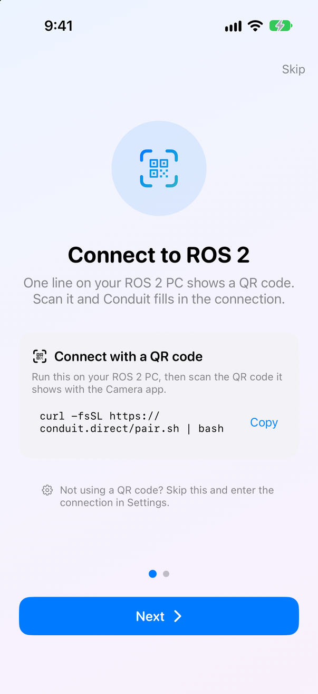
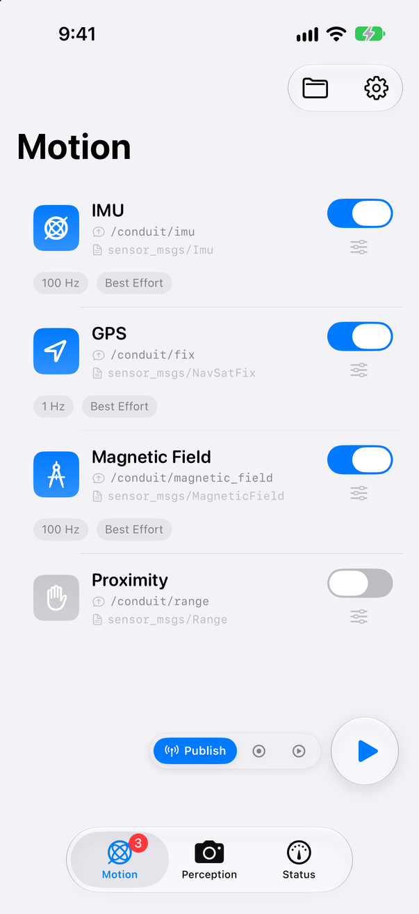
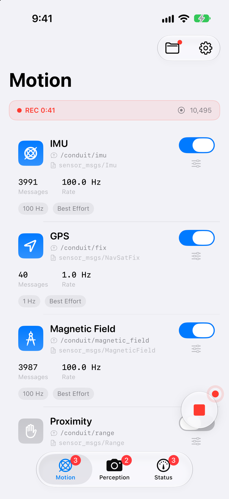
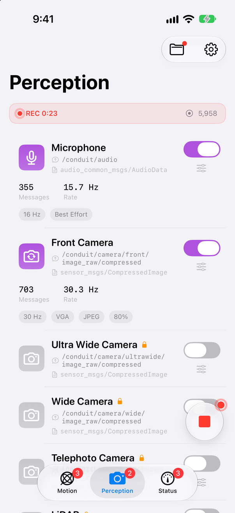
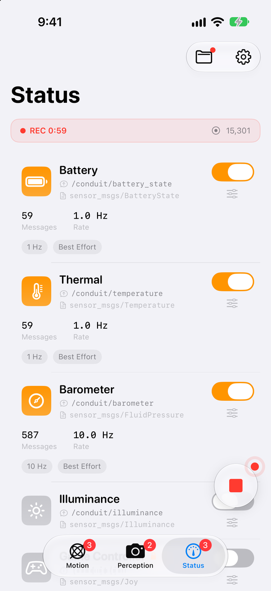
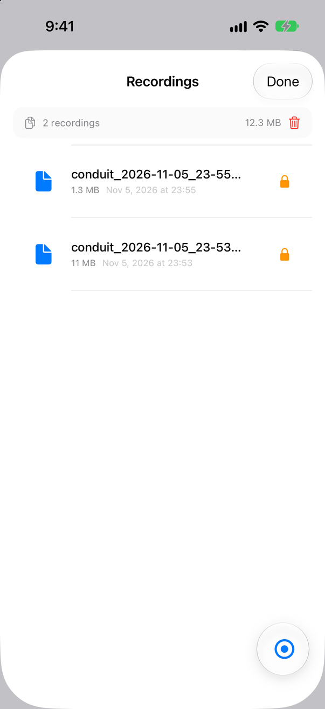
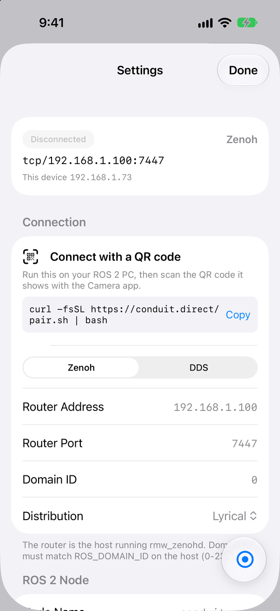
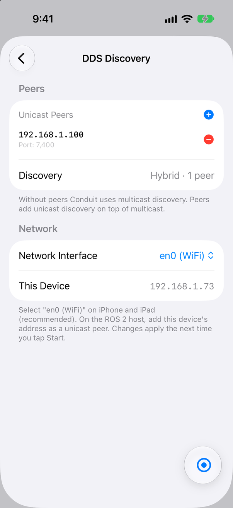

<div align="center">

<a href="https://apps.apple.com/app/apple-store/id6757171237?pt=1392401&amp;ct=conduit-direct&amp;mt=8">

</a>

# Conduit

</div>

**Your iPhone, iPad or Mac as a ROS 2 sensor**

Conduit publishes the sensors of your Apple device to a ROS 2 graph over **Zenoh** or **DDS**. No bridge, no `rcl` / `rclcpp`, nothing to build on the device. Scan a QR code from your ROS 2 PC and the topics show up in `ros2 topic list`.
Conduit has been downloaded over 10,000 times and has ranked as high as **#4 in Developer Tools** on the Japanese App Store.

[](https://docs.ros.org)
[](https://github.com/swift-ros2/swift-ros2)

---

## Get started

1. **Install** Conduit from the [App Store](https://apps.apple.com/app/apple-store/id6757171237?pt=1392401&ct=conduit-direct&mt=8).
2. **On your ROS 2 PC** (Ubuntu, RHEL or Fedora, with ROS 2 sourced), run:
    ```bash
    curl -fsSL https://conduit.direct/pair.sh | bash
    ```
    The script checks the setup and shows a QR code.
3. **Scan the QR code** with the iPhone's Camera app. Conduit opens and fills in the connection settings.
4. **Turn on sensors and tap Start**, then check on the PC:
    ```bash
    ros2 topic echo /conduit/imu
    ```

QR pairing needs Conduit 2.6.0 or later. See [Connect with a QR code](docs/pair.md) for the requirements, Tailscale and troubleshooting.

<details>
<summary><b>Set up by hand: Zenoh</b></summary>

1. Start the Zenoh router on your ROS 2 PC:
    ```bash
    source /opt/ros/lyrical/setup.bash   # or jazzy / humble / …
    export RMW_IMPLEMENTATION=rmw_zenoh_cpp
    export ROS_DOMAIN_ID=0  # 0-232
    ros2 run rmw_zenoh_cpp rmw_zenohd
    ```
2. In Conduit, open Settings: **Transport** Zenoh, **Router Address** the PC's IP, **Router Port** `7447`, **Domain ID** the same as the PC, and **Distribution** your ROS 2 release (Lyrical for new installs). Tap **Done**.
3. Turn on sensors and tap Start.
4. Check: `ros2 topic echo /conduit/imu`

</details>

<details>
<summary><b>Set up by hand: DDS (CycloneDDS)</b></summary>

1. On your ROS 2 PC, add the iPhone as a discovery peer and restart the ROS 2 daemon:
    ```bash
    source /opt/ros/lyrical/setup.bash   # or jazzy / humble / …
    export RMW_IMPLEMENTATION=rmw_cyclonedds_cpp
    export ROS_DOMAIN_ID=0  # 0-232
    export CYCLONEDDS_URI='<CycloneDDS><Domain><Discovery><Peers><Peer address="IPHONE_IP"/></Peers></Discovery></Domain></CycloneDDS>'
    ros2 daemon stop
    ```
    Settings → Discovery → **This Device** in Conduit shows the iPhone's address.
2. In Conduit, open Settings: **Transport** DDS, **Domain ID** the same as the PC, **Distribution** your ROS 2 release. In **Discovery**, add the PC's IP under **Peers** and pick **en0 (WiFi)** as the **Network Interface**. Tap **Done**.
3. Turn on sensors and tap Start.
4. Check: `ros2 topic echo /conduit/imu --qos-reliability best_effort`

Run `ros2 daemon stop` again whenever you change `RMW_IMPLEMENTATION`, `ROS_DOMAIN_ID` or `CYCLONEDDS_URI`: the daemon keeps its first settings. See [Troubleshooting](docs/troubleshooting.md#ros2-cli-shows-stale-topics-after-changing-rmw_implementation-or-cyclonedds_uri).

</details>

---

## Demo videos

<table>
<tr>
<td align="center" width="33%">
<a href="https://www.youtube.com/watch?v=2myDfnNBuuk">
<br>
<b>Getting Started</b>
</a><br>
<sub>Connect Conduit to your ROS 2 system step by step</sub>
</td>
<td align="center" width="33%">
<a href="https://www.youtube.com/watch?v=ObnJOpGvpzI">
<br>
<b>Camera & LiDAR</b>
</a><br>
<sub>Stream camera images and LiDAR point clouds to ROS 2</sub>
</td>
<td align="center" width="33%">
<a href="https://www.youtube.com/watch?v=d28sQYQlpYY">
<br>
<b>Teleoperation</b>
</a><br>
<sub>Drive a robot with a game controller through ROS 2 Joy messages</sub>
</td>
</tr>
<tr>
<td align="center" width="33%">
<a href="https://www.youtube.com/watch?v=TgNgDvFeAMs">
<br>
<b>Cyclone DDS</b>
</a><br>
<sub>Talk to ROS 2 over Cyclone DDS, with no Zenoh router</sub>
</td>
<td align="center" width="33%">
<a href="https://www.youtube.com/watch?v=yhI3eWcWSNQ">
<br>
<b>MCAP Recording</b>
</a><br>
<sub>Record every topic to an MCAP file for Foxglove or ros2 bag</sub>
</td>
<td align="center" width="33%"></td>
</tr>
</table>

### Coming in Conduit 3: Robots

Conduit 3 subscribes as well as publishes: watch a robot's camera, map and diagnostics, and drive it from the phone. See [Robots](docs/robots.md).

<table>
<tr>
<td align="center" width="50%">
<a href="https://www.youtube.com/watch?v=tERF16pEvUA">
<br>
<b>Drive a mobile robot</b>
</a><br>
<sub>Drive a robot through its own camera from your iPhone</sub>
</td>
<td align="center" width="50%">
<a href="https://www.youtube.com/watch?v=5x5xeL3mKAI">
<br>
<b>Move a robot arm</b>
</a><br>
<sub>Move a MoveIt Servo arm by moving your iPhone</sub>
</td>
</tr>
</table>

---

## What Conduit publishes

### 13 sensors

- **Motion**: IMU (100 Hz) · Magnetometer (100 Hz) · GPS (1 Hz) · Proximity (10 Hz) · Device Pose (60 Hz, Conduit 3)
- **Perception**: Camera (30 Hz) · LiDAR (30 Hz, point cloud or depth image) · Microphone (`audio_common_msgs/AudioData`)
- **Environment**: Barometer (10 Hz) · Illuminance (10 Hz) · Thermal (1 Hz)
- **Input**: Game Controller (`sensor_msgs/Joy`, 50 Hz, Reliable)
- **Status**: Battery (1 Hz)

Every topic, message type and frame: [Sensors and topics](docs/sensors.md).

| Device | Sensors |
|--------|---------|
| iPhone (iOS 16+) | All 13. LiDAR on Pro models (iPhone 12 Pro and later) |
| iPad (iPadOS 16+) | All except Proximity. LiDAR on iPad Pro (2020 and later) |
| Mac (macOS 13+, Mac Catalyst) | Camera, Microphone, Battery, Thermal, Game Controller |

### Transports

| Transport | ROS 2 RMW | Router required | Best for |
|-----------|-----------|-----------------|----------|
| **Zenoh** | `rmw_zenoh_cpp` | Yes (`rmw_zenohd`) | Across subnets, over Tailscale, networks without multicast |
| **DDS**   | `rmw_cyclonedds_cpp` | No | One LAN, an existing CycloneDDS setup |

See [Zenoh or DDS](docs/transports.md).

### MCAP recording

Record every topic to an **MCAP** file and open it in [Foxglove](https://foxglove.dev/) or replay it with `ros2 bag play`. Recording is free and works without a network: pick **Record** instead of **Publish** next to the Start button. The message schemas are written into the file, so it opens without your `.msg` files. See [Recording (MCAP)](docs/recording.md).

### In-app purchases

IMU, Magnetometer, GPS, Proximity, Barometer, Illuminance, Thermal, Battery, Microphone, the front camera and MCAP recording are free. One-time purchases unlock the **Back Cameras** (Wide, Ultra Wide and Telephoto), **LiDAR**, **Game Controller**, **Background Mode** and **Recording Export** (sharing recordings off the device).

---

## Screenshots

<table>
<tr>
<td align="center" width="25%">
<br>
<b>Connect</b><br>
<sub>Run one line on your ROS 2 PC and scan the QR code it shows</sub>
</td>
<td align="center" width="25%">
<br>
<b>Pick sensors</b><br>
<sub>Turn sensors on, choose Publish, Record or Both, and tap Start</sub>
</td>
<td align="center" width="25%">
<br>
<b>Motion</b><br>
<sub>IMU, GPS, Magnetic Field and Proximity with live rates</sub>
</td>
<td align="center" width="25%">
<br>
<b>Perception</b><br>
<sub>Microphone, cameras and LiDAR</sub>
</td>
</tr>
<tr>
<td align="center" width="25%">
<br>
<b>Status</b><br>
<sub>Battery, Thermal, Barometer, Illuminance and Game Controller</sub>
</td>
<td align="center" width="25%">
<br>
<b>Recordings</b><br>
<sub>MCAP files on the device, behind the folder button</sub>
</td>
<td align="center" width="25%">
<br>
<b>Settings</b><br>
<sub>Transport, router, Domain ID and Distribution</sub>
</td>
<td align="center" width="25%">
<br>
<b>DDS Discovery</b><br>
<sub>Peers and network interface for DDS</sub>
</td>
</tr>
</table>

---

## Docker test environments

### Zenoh router (Docker)

Pre-built images on ghcr.io:
```bash
# ROS 2 Lyrical
docker run -d -p 7447:7447 --name ros_lyrical_zenoh ghcr.io/youtalk/conduit-support:lyrical
# ROS 2 Jazzy
docker run -d -p 7447:7447 --name ros_jazzy_zenoh ghcr.io/youtalk/conduit-support:jazzy
# ROS 2 Humble
docker run -d -p 7447:7447 --name ros_humble_zenoh ghcr.io/youtalk/conduit-support:humble
```

Or with Docker Compose:
```bash
git clone https://github.com/youtalk/conduit-support.git
cd conduit-support/docker

# Default domain ID (0)
docker compose up ros-lyrical -d

# Custom domain ID via .env (recommended for persistence)
echo "ROS_DOMAIN_ID=5" > .env
docker compose up ros-lyrical -d

# Or override per-invocation
ROS_DOMAIN_ID=5 docker compose up ros-lyrical -d

# Stop
docker compose down
```

### DDS subscriber (Docker, Linux only)

> **macOS note:** Docker Desktop on macOS does not provide true host networking, so the container cannot receive DDS traffic from an iPhone on the same LAN. On macOS, run your DDS subscriber natively or in a Parallels/UTM VM.

```bash
cd conduit-support/docker
echo "ROS_DOMAIN_ID=0" > .env
docker compose -f compose-dds.yml up ros-lyrical-dds -d

# Verify
docker exec -it ros_lyrical_dds bash
source /opt/ros/lyrical/setup.bash
ros2 topic list
ros2 topic echo /conduit/imu --qos-reliability best_effort
```

See [docker/README.md](docker/README.md) for the complete Docker guide.

---

## Built on swift-ros2

All of Conduit's ROS 2 work (Zenoh and DDS transports, the CDR codec, the Humble to Rolling wire formats, publishers and subscriptions) is done by [**swift-ros2**](https://github.com/swift-ros2/swift-ros2), a native Swift client library for ROS 2 that started inside Conduit. To put ROS 2 in your own Swift app, use swift-ros2 directly: it runs on iOS, iPadOS, macOS, Mac Catalyst and visionOS, and builds from source on Linux, Windows and Android.

---

## Documentation

- [Connect with a QR code](docs/pair.md): the fastest way to connect
- [Zenoh or DDS](docs/transports.md): which transport to use
- [Platform notes](docs/platform-notes.md): what each device supports
- [Sensors and topics](docs/sensors.md): every topic, message type, rate and frame
- [Recording (MCAP)](docs/recording.md): record, open and share MCAP files
- [On-demand capture](docs/on-demand-capture.md): publish only when subscribed
- [Game controller teleop](docs/teleop.md): drive a robot with `teleop_twist_joy`
- [Robots](docs/robots.md): coming in Conduit 3
- [FAQ](docs/faq.md), [Troubleshooting](docs/troubleshooting.md), [Known issues](docs/known-issues.md)
- [Privacy policy](docs/privacy.md)

---

## Support

- [Report a bug or request a feature](https://github.com/youtalk/conduit-support/issues/new/choose)
- [Community discussions](https://github.com/youtalk/conduit-support/discussions)

## Links

- [Website](https://conduit.direct)
- [Conduit on the App Store](https://apps.apple.com/app/apple-store/id6757171237?pt=1392401&ct=conduit-direct&mt=8)
- [swift-ros2](https://github.com/swift-ros2/swift-ros2)
